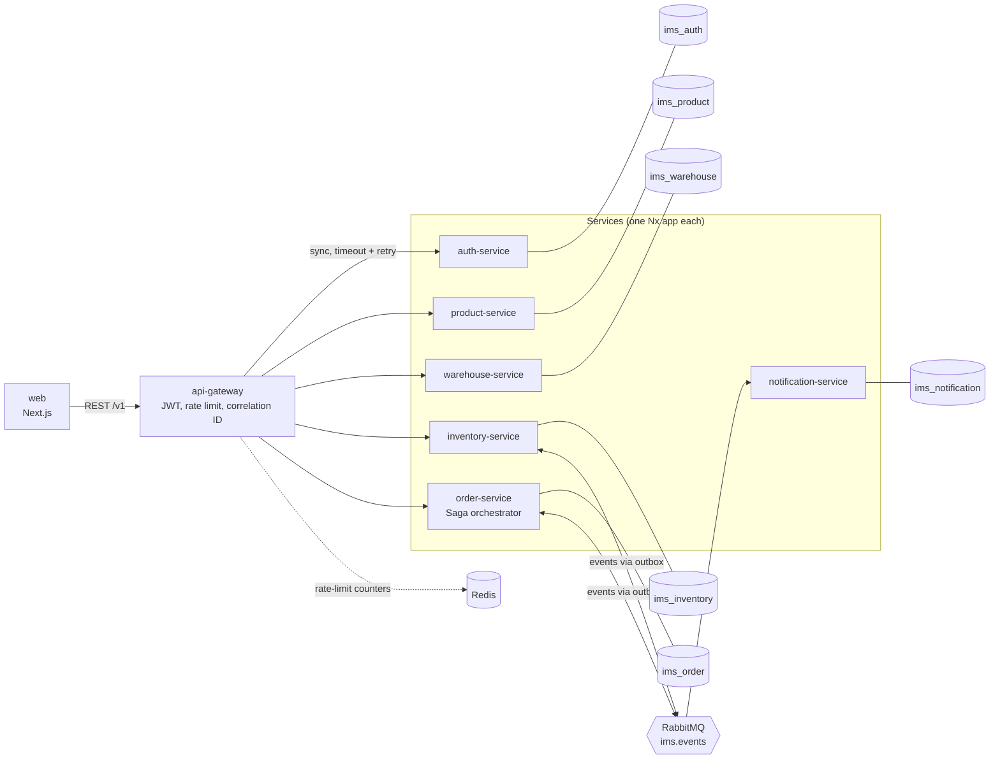
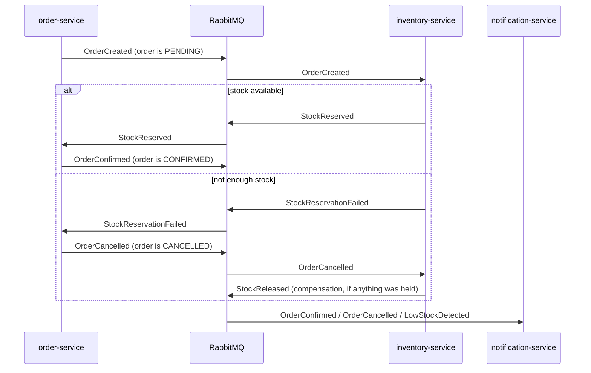

# Inventory Management System

An MVP of an enterprise-style inventory system, built as an Nx monorepo of
NestJS microservices with a Next.js frontend.

> **Build status:** Phase 1 of 7 is complete (workspace, tooling, shared libs,
> local infrastructure). Services and the frontend arrive in later phases; see
> [Roadmap](#roadmap).

## Architecture



**Order saga** (orchestrated by order-service, all steps asynchronous):



Key rules:

- The frontend talks **only** to `api-gateway`.
- Each service owns its **own database**; no service reads another's tables.
- Events are written to an **outbox table** in the same transaction as the
  state change, then relayed to RabbitMQ (no lost or phantom events).
- Consumers are **idempotent**: they record processed event IDs.
- Stock rows use **optimistic locking** so concurrent orders cannot oversell.

## Tech stack

| Area      | Choice                                                       |
| --------- | ------------------------------------------------------------ |
| Monorepo  | Nx 22, pnpm 9, TypeScript 5.9 (strict)                       |
| Backend   | NestJS 11, TypeORM 0.3 (migrations only), PostgreSQL 16      |
| Messaging | RabbitMQ 3.13 (Amazon MQ in production)                      |
| Cache     | Redis 7                                                      |
| Frontend  | Next.js App Router, Tailwind, shadcn/ui, TanStack Query, Zod |
| Quality   | ESLint 9, Prettier, Jest 30, Husky, lint-staged, Commitlint  |

## Repository layout

```
apps/                     one folder per deployable (added from Phase 2)
libs/
  config/                 Zod env schemas + fail-fast validator
  common/                 guards, decorators, error filter, pagination, logger
  events/                 event names, payload contracts, envelope
  database/               TypeORM options factory, base entity, naming strategy
docker/postgres/          init script: one database per service
docker-compose.yml        Postgres, Redis, RabbitMQ
```

Shared libs contain **no business logic**. Dependencies are enforced by the
`@nx/enforce-module-boundaries` lint rule (see `eslint.config.mjs`):

```
apps      -> libs only (an app can never import another app)
config    -> (nothing)
events    -> (nothing)
common    -> config, events
database  -> config, common
```

## Getting started

Prerequisites: Node.js >= 22.12, pnpm 9 (`npm i -g pnpm@9`), Docker.

```bash
pnpm install        # install dependencies and git hooks
pnpm setup:env      # copy every .env.example to .env (skips existing files)
pnpm docker:up      # start Postgres, Redis, RabbitMQ and wait until healthy
pnpm dev            # start every service and the frontend (from Phase 2)
```

Local infrastructure:

| Service     | Address                  | Credentials                  |
| ----------- | ------------------------ | ---------------------------- |
| PostgreSQL  | `localhost:5433`         | `ims` / `ims_local_password` |
| Redis       | `localhost:6379`         | none                         |
| RabbitMQ    | `localhost:5672`         | `ims` / `ims_local_password` |
| RabbitMQ UI | <http://localhost:15672> | same as above                |

Databases created on first start: `ims_auth`, `ims_product`, `ims_warehouse`,
`ims_inventory`, `ims_order`, `ims_notification`.

## Scripts

| Command             | What it does                                          |
| ------------------- | ----------------------------------------------------- |
| `pnpm dev`          | Run all apps in watch mode                            |
| `pnpm lint`         | ESLint for every project, including module boundaries |
| `pnpm typecheck`    | `tsc --noEmit` for every project                      |
| `pnpm test`         | Jest for every project                                |
| `pnpm build`        | Build every app                                       |
| `pnpm verify`       | lint + typecheck + test + build                       |
| `pnpm format`       | Prettier write (`format:check` to verify only)        |
| `pnpm docker:up`    | Start local infrastructure                            |
| `pnpm docker:down`  | Stop it (data is kept)                                |
| `pnpm docker:reset` | Stop it and delete all data volumes                   |

Run one project: `pnpm nx test common`. Run only what a change affects:
`pnpm nx affected -t lint typecheck test build`.

## Configuration

- All configuration comes from environment variables. Real `.env` files are
  git-ignored; only `.env.example` files are committed.
- The root `.env` holds shared infrastructure settings and is also read by
  Docker Compose. Each service adds its own (`PORT`, `DB_NAME`, ...) in
  `apps/<service>/.env`.
- Every service validates its environment against a Zod schema at boot
  (`libs/config`). An invalid or missing value stops the process immediately
  with a message listing every problem.

## Conventions

- **Commits** follow [Conventional Commits](https://www.conventionalcommits.org)
  (`feat(inventory): add stock transfer`), checked by Commitlint on `commit-msg`.
- **Pre-commit** runs ESLint and Prettier on staged files through lint-staged.
- **Errors** from every service share one JSON shape (`ErrorResponse` in
  `libs/common`): `statusCode`, `error` code, `message`, optional `details`,
  `correlationId`, `timestamp`, `path`.
- **Logs** are structured JSON (Pino). Every line carries the
  `x-correlation-id` of the request or event being handled.

## Decisions

Choices made where the brief was open, favouring the simpler option:

1. **Tool versions are pinned to releases that support Node 22.12**
   (Nx 22, TypeScript 5.9, ESLint 9, NestJS 11, TypeORM 0.3). The newest
   majors (Nx 24, ESLint 10, TypeORM 1.x) need Node >= 22.13, NestJS 12 is
   ESM-only, and TypeScript 7 is not yet supported by ts-jest or
   typescript-eslint. Upgrading is a follow-up, not an MVP concern.
2. **pnpm is installed with npm**, not Corepack, because the Corepack bundled
   with Node 22.12 fails signature verification for current pnpm releases.
3. **Single `package.json`** (Nx integrated style) instead of one per project:
   one version of every dependency, less boilerplate.
4. **Libs are not built separately.** Apps import them through TypeScript path
   aliases (`@ims/*`) and bundle them at build time. Libs still have their own
   `lint`, `typecheck` and `test` targets.
5. **One Postgres server locally, one database per service.** The isolation
   that matters (no shared schema, no cross-service queries) is kept, without
   running six containers. Production can use separate instances by changing
   `DB_HOST` per service.
6. **Role-to-permission mapping is static code** in `libs/common`, and the
   permissions are embedded in the access token. No permission tables or
   admin UI for the MVP.
7. **Docker Compose runs infrastructure only.** Services run on the host with
   `pnpm dev` for fast reloads; per-app Dockerfiles come in Phase 7.

## Roadmap

| Phase | Scope                                                           | Status  |
| ----- | --------------------------------------------------------------- | ------- |
| 1     | Workspace, tooling, shared libs, Docker Compose, root README    | Done    |
| 2     | auth-service + api-gateway, login working end to end            | Next    |
| 3     | product-service, warehouse-service                              | Pending |
| 4     | inventory-service: stock rules, movement history                | Pending |
| 5     | order-service (Saga, Outbox, idempotency), notification-service | Pending |
| 6     | Next.js frontend, all MVP screens                               | Pending |
| 7     | Tests, Swagger, Dockerfiles, GitHub Actions, final README       | Pending |
