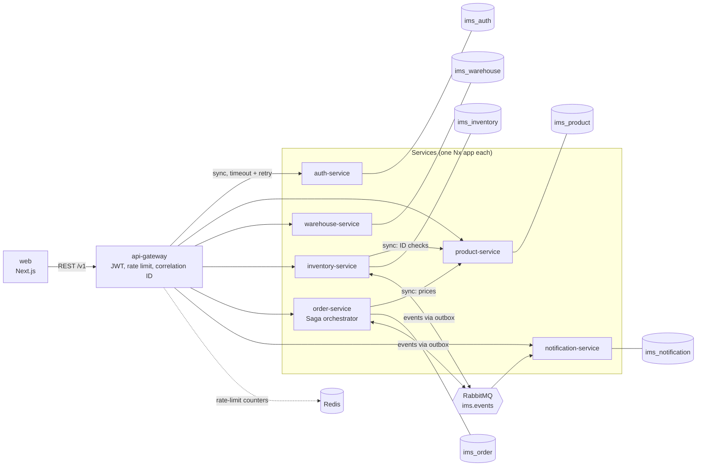
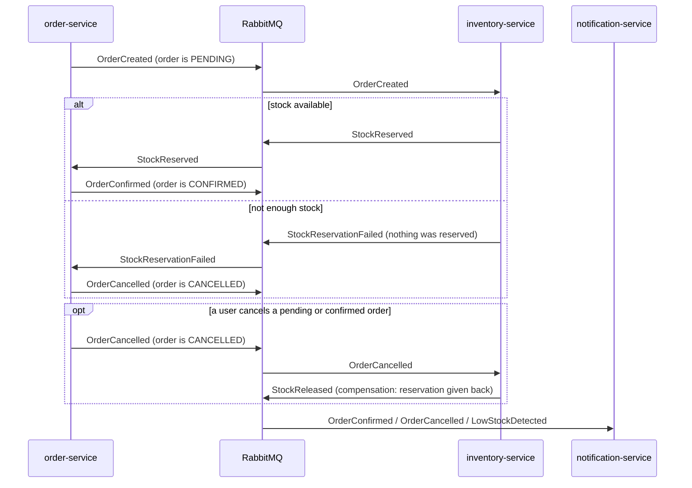

# Inventory Management System

An MVP of an enterprise-style inventory system, built as an Nx monorepo of
NestJS microservices with a Next.js frontend.

Seven backend services and a web frontend run locally with one command.
Placing an order reserves stock, confirms or cancels the order and sends a
notification, entirely through events.

- **New here?** Start with [Getting started](#getting-started).
- **Want the reasoning?** See [Decisions](#decisions) and the
  [5-minute architecture summary](docs/interview-summary.md).
- **Going to production?** See [Deploying to AWS](#deploying-to-aws) and
  [Known limitations](#known-limitations).

## Architecture



**Order saga** (orchestrated by order-service, all steps asynchronous):



How one step works, taking "inventory-service reserves stock" as the example:

1. RabbitMQ delivers `OrderCreated` to the `ims.inventory.events` queue.
2. In **one database transaction** inventory-service records the event ID
   (so a redelivery is recognised), reserves the stock, and writes
   `StockReserved` to its `outbox_events` table.
3. It acknowledges the message. If it crashes before that, RabbitMQ
   redelivers and step 2 sees the event ID and does nothing.
4. The outbox relay publishes `StockReserved` and marks the row published. If
   RabbitMQ is down the row simply waits; nothing is lost, events are late.

Key rules:

- The frontend talks **only** to `api-gateway`.
- Each service owns its **own database**; no service reads another's tables.
- Events are written to an **outbox table** in the same transaction as the
  state change, then relayed to RabbitMQ (no lost or phantom events).
- Consumers are **idempotent**: they record processed event IDs.
- Stock rows use **optimistic locking** so concurrent orders cannot oversell.

## Tech stack

| Area      | Choice                                                       |
| --------- | ------------------------------------------------------------ |
| Monorepo  | Nx 22, pnpm 9, TypeScript 5.9 (strict)                       |
| Backend   | NestJS 11, TypeORM 0.3 (migrations only), PostgreSQL 16      |
| Build     | Vite 7 with SWC (one Node bundle per service)                |
| Messaging | RabbitMQ 3.13 (Amazon MQ in production)                      |
| Cache     | Redis 7                                                      |
| Frontend  | Next.js App Router, Tailwind, shadcn/ui, TanStack Query, Zod |
| Quality   | ESLint 9, Prettier, Jest 30, Husky, lint-staged, Commitlint  |

## Repository layout

```
apps/
  api-gateway/            entry point: JWT check, rate limit, routing
  auth-service/           users, login, refresh, logout
  product-service/        categories, products (SKU, price, JSONB attributes)
  warehouse-service/      warehouses and their storage locations
  inventory-service/      stock levels, movements, reservations for orders
  order-service/          orders and the saga that reserves stock for them
  notification-service/   turns events into (mock) emails
  web/                    Next.js frontend: all MVP screens
libs/
  config/                 Zod env schemas + fail-fast validator
  common/                 guards, decorators, error filter, pagination, logger,
                          RabbitMQ publisher and consumer helpers
  events/                 event names, payload contracts, envelope
  database/               TypeORM options factory, base entity, naming strategy,
                          Postgres error helpers, health check, outbox relay,
                          idempotent-consumer helper
docker/postgres/          init script: one database per service
docker-compose.yml        Postgres, Redis, RabbitMQ
tools/scaffold-app.sh     writes the Nx/Jest/Vite boilerplate for a new app
tools/vite/nest-app.ts    shared Vite + SWC config for every NestJS app
```

Shared libs contain **no business logic**. Dependencies are enforced by the
`@nx/enforce-module-boundaries` lint rule (see `eslint.config.mjs`):

```
apps      -> libs only (an app can never import another app)
config    -> (nothing)
events    -> (nothing)
common    -> config, events
database  -> config, common, events
```

## Getting started

Prerequisites: Node.js >= 22.12, pnpm 9 (`npm i -g pnpm@9`), Docker.

```bash
pnpm install        # install dependencies and git hooks
pnpm setup:env      # copy every .env.example to .env (skips existing files)
pnpm docker:up      # start Postgres, Redis, RabbitMQ and wait until healthy
pnpm dev            # start every service and the frontend in watch mode
```

Then open <http://localhost:3001> and sign in as `admin@ims.local`,
`manager@ims.local` or `staff@ims.local`.

To call the API directly, sign in through the gateway (seed users and their
password are listed in
[apps/auth-service/README.md](apps/auth-service/README.md#seed-users)):

```bash
curl -s -X POST http://localhost:4000/v1/auth/login \
  -H 'content-type: application/json' \
  -d '{"email":"admin@ims.local","password":"<SEED_USER_PASSWORD>"}'
```

Services:

| App                                                         | Port | API docs                     | Health    |
| ----------------------------------------------------------- | ---- | ---------------------------- | --------- |
| [web](apps/web/README.md)                                   | 3001 | n/a                          | n/a       |
| [api-gateway](apps/api-gateway/README.md)                   | 4000 | <http://localhost:4000/docs> | `/health` |
| [auth-service](apps/auth-service/README.md)                 | 4001 | <http://localhost:4001/docs> | `/health` |
| [product-service](apps/product-service/README.md)           | 4002 | <http://localhost:4002/docs> | `/health` |
| [warehouse-service](apps/warehouse-service/README.md)       | 4003 | <http://localhost:4003/docs> | `/health` |
| [inventory-service](apps/inventory-service/README.md)       | 4004 | <http://localhost:4004/docs> | `/health` |
| [order-service](apps/order-service/README.md)               | 4005 | <http://localhost:4005/docs> | `/health` |
| [notification-service](apps/notification-service/README.md) | 4006 | <http://localhost:4006/docs> | `/health` |

Local infrastructure:

| Service     | Address                  | Credentials                  |
| ----------- | ------------------------ | ---------------------------- |
| PostgreSQL  | `localhost:5433`         | `ims` / `ims_local_password` |
| Redis       | `localhost:6379`         | none                         |
| RabbitMQ    | `localhost:5672`         | `ims` / `ims_local_password` |
| RabbitMQ UI | <http://localhost:15672> | same as above                |

Databases created on first start: `ims_auth`, `ims_product`, `ims_warehouse`,
`ims_inventory`, `ims_order`, `ims_notification`.

## Scripts

| Command             | What it does                                            |
| ------------------- | ------------------------------------------------------- |
| `pnpm dev`          | Run all apps in watch mode                              |
| `pnpm lint`         | ESLint for every project, including module boundaries   |
| `pnpm typecheck`    | `tsc --noEmit` for every project                        |
| `pnpm test`         | Unit tests for every project (no infrastructure needed) |
| `pnpm test:int`     | Integration tests (needs `pnpm docker:up`)              |
| `pnpm build`        | Build every app                                         |
| `pnpm verify`       | lint + typecheck + test + build                         |
| `pnpm format`       | Prettier write (`format:check` to verify only)          |
| `pnpm docker:up`    | Start local infrastructure                              |
| `pnpm docker:down`  | Stop it (data is kept)                                  |
| `pnpm docker:reset` | Stop it and delete all data volumes                     |

Run one project: `pnpm nx test common`. Run only what a change affects:
`pnpm nx affected -t lint typecheck test build`.

## Testing

| Kind        | Command         | Needs                    | What it covers                                                      |
| ----------- | --------------- | ------------------------ | ------------------------------------------------------------------- |
| Unit        | `pnpm test`     | nothing                  | Pure logic: stock rules, order state machine, guards, API client... |
| Integration | `pnpm test:int` | Postgres, Redis (Docker) | Each service booted for real against its own test database          |

- **The core rules are pure functions**, so they are tested without mocks:
  stock rules (`apps/inventory-service/src/stock/stock-rules.ts`) and the
  order state machine (`apps/order-service/src/saga/order-state.ts`).
- **Every service has an integration test** that starts the real Nest
  application, runs its migrations on a `*_test` database and drives it over
  HTTP. Calls to other services are replaced with fakes.
- **Concurrency is tested for real**: simultaneous stock-outs and
  simultaneous orders against the same stock must never oversell.
- **Event flows are tested without a broker**: handlers are called directly
  (including duplicate and out-of-order deliveries) and the outbox relay is
  driven with a fake publisher.

## CI/CD

Two GitHub Actions workflows:

| Workflow                                     | Runs on                                                 | Does                                                                                                                                                      |
| -------------------------------------------- | ------------------------------------------------------- | --------------------------------------------------------------------------------------------------------------------------------------------------------- |
| [`ci.yml`](.github/workflows/ci.yml)         | every PR, and `main`                                    | Install, commit-message check, format check, then lint, type-check, test, build and integration tests for the projects the change affects (`nx affected`) |
| [`docker.yml`](.github/workflows/docker.yml) | `main`, and PRs that touch a Dockerfile or dependencies | Builds one image per app, tagged with the commit SHA                                                                                                      |

Pushing images to Amazon ECR and deploying are marked `TODO(aws)` in
`docker.yml`, with the steps written out as comments; they need an AWS
account. The intended flow is trunk-based: short-lived branch, PR, green CI,
squash-merge, images built from `main`, deploy by SHA.

## Docker images

Each app has a multi-stage `Dockerfile` that runs as the unprivileged `node`
user. The build context is the repository root:

```bash
docker build -f apps/order-service/Dockerfile -t ims/order-service .
docker build -f apps/web/Dockerfile -t ims/web \
  --build-arg NEXT_PUBLIC_API_URL=http://localhost:4000/v1 .
```

- The seven NestJS Dockerfiles are identical apart from the app name and
  port; they are generated from `tools/nest-service.Dockerfile.tpl` by
  `tools/scaffold-app.sh`, so they cannot drift apart.
- Images contain no `.env` file. All configuration is injected as
  environment variables at run time.
- Each image has a `HEALTHCHECK` on the service's `/health` endpoint, and
  handles `SIGTERM` (finish in-flight work, close connections, exit 0).

## Deploying to AWS

Nothing in the code is AWS-specific; each local piece has a managed
equivalent, selected through environment variables:

| Local (Docker Compose)       | AWS                                                    | Changes needed                               |
| ---------------------------- | ------------------------------------------------------ | -------------------------------------------- |
| Apps run with `pnpm dev`     | ECS Fargate, one service per app, images in ECR        | Enable the `TODO(aws)` steps in `docker.yml` |
| Postgres, one DB per service | RDS for PostgreSQL (one instance, or one each)         | `DB_HOST`, `DB_SSL=true` per service         |
| RabbitMQ                     | Amazon MQ for RabbitMQ                                 | `RABBITMQ_URL` (`amqps://`)                  |
| Redis                        | ElastiCache                                            | `REDIS_URL`                                  |
| `.env` files                 | Secrets Manager / SSM, injected by the task definition | none in code                                 |
| Gateway on `localhost:4000`  | Application Load Balancer in front of api-gateway only | `CORS_ORIGINS`; other services stay private  |
| JSON logs on stdout          | CloudWatch Logs                                        | none; search by `correlationId`              |

Before a first production deploy: set `DB_MIGRATIONS_RUN=false` and run
migrations as a one-off task, set `SEED_DATA=false`, and generate real
`JWT_*_SECRET` values.

## Known limitations

Deliberate MVP boundaries, each with its upgrade path:

- **No shipping step.** Orders stop at `CONFIRMED` with stock reserved.
  Fulfilment would add a status and turn the reservation into a stock-out.
- **Stock is per warehouse, not per storage location.**
- **A stuck saga is not timed out.** If inventory-service were down for
  long, orders would stay `PENDING` until it returned. A scheduled job that
  cancels orders pending for too long is the usual addition.
- **The dead-letter queue is not monitored or replayed.** Messages that fail
  twice wait in `ims.events.dlq` for a human.
- **Outbox rows and processed-event IDs are kept forever.** A periodic
  clean-up of old rows is needed at volume.
- **Access tokens cannot be revoked** before their 15-minute expiry, and a
  role change takes effect at the next refresh.
- **Health checks cover the database (or Redis) only**, not RabbitMQ.
- **No end-to-end browser tests.** The frontend was checked by hand; the
  warehouses screens and several dialogs were not clicked through.
- **No metrics or tracing**, only correlated logs. OpenTelemetry is the next
  step.
- **Service images share one dependency set** (single `package.json`), so
  each carries packages other services use.

## Configuration

- All configuration comes from environment variables. Real `.env` files are
  git-ignored; only `.env.example` files are committed.
- The root `.env` holds shared infrastructure settings and is also read by
  Docker Compose. Each service adds its own (`PORT`, `DB_NAME`, ...) in
  `apps/<service>/.env`.
- Every service validates its environment against a Zod schema at boot
  (`libs/config`). An invalid or missing value stops the process immediately
  with a message listing every problem.

## Conventions

- **Commits** follow [Conventional Commits](https://www.conventionalcommits.org)
  (`feat(inventory): add stock transfer`), checked by Commitlint on `commit-msg`.
- **Pre-commit** runs ESLint and Prettier on staged files through lint-staged.
- **Errors** from every service share one JSON shape (`ErrorResponse` in
  `libs/common`): `statusCode`, `error` code, `message`, optional `details`,
  `correlationId`, `timestamp`, `path`.
- **Logs** are structured JSON (Pino). Every line carries the
  `x-correlation-id` of the request or event being handled.

## Decisions

Choices made where the brief was open, favouring the simpler option:

1. **Tool versions are pinned to releases that support Node 22.12**
   (Nx 22, TypeScript 5.9, ESLint 9, NestJS 11, TypeORM 0.3). The newest
   majors (Nx 24, ESLint 10, TypeORM 1.x) need Node >= 22.13, NestJS 12 is
   ESM-only, and TypeScript 7 is not yet supported by ts-jest or
   typescript-eslint. Upgrading is a follow-up, not an MVP concern.
2. **pnpm is installed with npm**, not Corepack, because the Corepack bundled
   with Node 22.12 fails signature verification for current pnpm releases.
3. **Single `package.json`** (Nx integrated style) instead of one per project:
   one version of every dependency, less boilerplate.
4. **Libs are not built separately.** Apps import them through TypeScript path
   aliases (`@ims/*`) and bundle them at build time. Libs still have their own
   `lint`, `typecheck` and `test` targets.
5. **Services are built with Vite, compiled by SWC.** Vite's default
   compiler (esbuild) cannot emit the decorator metadata NestJS dependency
   injection needs, so the SWC plugin does the TypeScript transform. The
   shared config is `tools/vite/nest-app.ts`. Two consequences: the build
   does not type-check (the `typecheck` target runs `tsc` for that), and an
   interface used as the type of a decorated parameter must be imported with
   `import type`. In development, `vite build --watch` rebuilds the bundle
   and `node --watch` restarts the service.
6. **One Postgres server locally, one database per service.** The isolation
   that matters (no shared schema, no cross-service queries) is kept, without
   running six containers. Production can use separate instances by changing
   `DB_HOST` per service.
7. **Role-to-permission mapping is static code** in `libs/common`, and the
   permissions are embedded in the access token. No permission tables or
   admin UI for the MVP.
8. **Docker Compose runs infrastructure only.** Services run on the host with
   `pnpm dev` for fast reloads; per-app Dockerfiles come in Phase 7.
9. **Synchronous calls use HTTP, not Nest TCP.** Every service needs an HTTP
   server anyway (Swagger, health checks), so the gateway forwards plain HTTP
   with a timeout and retries for idempotent requests. One protocol to debug,
   and services stay callable with curl.
10. **The gateway is a generic reverse proxy** driven by a routing table,
    rather than one hand-written controller per downstream endpoint. Request
    and response contracts are documented once, in each service's own Swagger.
11. **Every service verifies the JWT itself** instead of trusting identity
    headers set by the gateway. Verification is a local signature check, so
    it costs no network call, and a service is safe even if reached directly.
12. **Migrations run at service startup** (`DB_MIGRATIONS_RUN=true`) and are
    hand-written SQL. This keeps `pnpm dev` to one command. In production,
    set it to `false` and run migrations as a separate deploy step.
13. **Seed data is created at startup** when `SEED_DATA=true`, by an
    idempotent seeder inside each service, rather than by a separate script.
14. **Refresh tokens are JWTs with a server-side record** (hash only), which
    gives rotation, logout and reuse detection without a session store.
15. **Unit and integration tests are separate targets** (`test`, `test-int`),
    so unit tests never need Docker. CI runs both.
16. **Products and warehouses are archived, never deleted.** `DELETE` sets
    `isActive=false`. Stock and orders in other services refer to these IDs,
    and with a database per service there is no foreign key to protect those
    references. Categories and storage locations, which nothing outside
    their own service refers to, are deleted for real.
17. **Uniqueness is enforced by database constraints,** and the services
    translate the constraint violation into a `409` with a specific error
    code. There is no "check first, then insert", which would still lose a
    race between two concurrent requests.
18. **Product search uses `ILIKE`** on SKU and name, which is a sequential
    scan. That is fine at MVP size; a `pg_trgm` index is the next step if
    the catalogue grows. Attribute filtering does use an index (GIN).
19. **Seed rows have fixed IDs,** so the seed data of later services (stock
    levels, orders) can refer to the same products and warehouses without
    calling across services at startup.
20. **Stock is tracked per product per warehouse,** not per storage location.
    Locations are reference data for now; bin-level stock would add a
    dimension to every stock rule without changing the architecture.
21. **Stock changes use optimistic locking written out by hand**
    (`UPDATE ... WHERE id = ? AND version = ?`, retried up to 3 times) rather
    than TypeORM's `@VersionColumn`, so the mechanism is visible in one
    place. `CHECK` constraints in the database are the last line of defence
    against negative stock.
22. **inventory-service checks product and warehouse IDs only the first time**
    stock is recorded for a pair, with a synchronous call (timeout + retries)
    to the owning service. Later movements need no cross-service call, so
    day-to-day stock work keeps running if the catalogue is down.
23. **Stock responses carry IDs, not product or warehouse names.** Copying
    names into inventory-service would need events to keep them fresh; the
    frontend joins them from the catalogue instead.
24. **Low stock is announced once per crossing.** Stock items carry a flag
    and can be filtered by it; the `LowStockDetected` event is published
    only at the moment an item drops to or below its threshold, not on every
    later movement while it stays low.
25. **One topic exchange, one queue per consuming service.** Events are
    published to `ims.events` with the event name as routing key; each
    service's queue is bound once per event it handles. Publishers do not
    know who is listening, and adding a consumer needs no publisher change.
    This uses the NestJS RabbitMQ transport's exchange support, not a custom
    client.
26. **The outbox relay polls** (every second by default) rather than tailing
    the database log. Polling is a few lines of code and adds at most a
    second of delay; change-data-capture is the upgrade if that matters.
27. **Delivery is at-least-once; handlers are idempotent.** Every handler
    records the event ID and does its work in one transaction. A message
    that fails is retried once, then moved to a dead-letter queue
    (`ims.events.dlq`) instead of blocking the queue.
28. **Each consumer handles one message at a time** (`prefetch 1`). It keeps
    a service's events in order; throughput comes from running more
    instances. Because instances can still interleave, inventory-service
    also copes with a cancellation that overtakes its order.
29. **An order is reserved all-or-nothing from one warehouse.** No partial
    fulfilment and no splitting across warehouses.
30. **Placing an order returns `PENDING` immediately.** Prices are fetched
    synchronously from product-service (and copied onto the order); stock is
    checked asynchronously by the saga. The client polls the order to see it
    become `CONFIRMED` or `CANCELLED`.
31. **Order status changes are single conditional updates**
    (`UPDATE ... WHERE id = ? AND status IN (...)`), which is all the
    locking the state machine needs: of two racing changes, one matches.
32. **Confirmed orders keep their stock reserved.** Shipping (which would
    turn a reservation into a stock-out) is outside the three statuses the
    MVP asks for.
33. **Emails are mocked.** notification-service logs and stores each email
    behind an `EmailSender` interface; a real provider is a one-line swap.
34. **Integration tests do not need RabbitMQ.** They call event handlers
    directly and drive the outbox relay with a fake publisher, so they test
    the logic, not the broker. The broker wiring was verified by hand,
    including an outage: orders placed while RabbitMQ was stopped completed
    once it was back.
35. **`amqp-connection-manager` is pinned to v4.** v5 depends on an ESM-only
    package that Jest cannot `require` on Node 22.12.
36. **The frontend runs on port 3001** and Next.js is pinned to 15 (the
    newest release line with the APIs used here well established).
37. **The frontend keeps its own copy of the API contract**
    (`apps/web/src/lib/api/types.ts`) instead of importing `@ims/*` libs.
    Those are server code (NestJS, TypeORM) and must not reach a browser
    bundle; a lint rule enforces it. Generating the types from the services'
    OpenAPI documents is the natural next step.
38. **Tokens: access token in memory, refresh token in `localStorage`.**
    Simple, and it keeps the frontend talking to the gateway only. The
    trade-off is that script injected into the page could read the refresh
    token; rotation with reuse detection limits the damage. An `HttpOnly`
    cookie set by the gateway is the hardening step.
39. **Route protection is client-side.** Pages are static shells that load
    data with the user's token, so there is nothing sensitive to protect on
    the Next.js server; the API enforces every permission.
40. **shadcn/ui components are written into the repo by hand**
    (`apps/web/src/components/ui`) rather than through its CLI, which is how
    shadcn/ui is meant to be used: you own the component code.
41. **Orders settle by polling.** The order pages re-fetch every 1.5 seconds
    while an order is `PENDING`. WebSockets or server-sent events would
    remove the delay at the cost of another moving part.
42. **The gateway's default rate limit is 600 requests a minute per IP**
    (was 120): one dashboard load is about ten requests, and a pending order
    polls.
43. **Frontend packages are `devDependencies`.** With one `package.json`,
    `dependencies` means "what the NestJS services need at run time", which
    is what `pnpm install --prod` puts in their images. Next.js bundles what
    the frontend needs at build time. This cut the service images from
    1.24 GB to about 500 MB.
44. **Images use `node:22-slim`** (Debian), not Alpine: the Argon2 native
    module ships prebuilt binaries for glibc, so nothing is compiled in the
    image.
45. **The image workflow builds but does not push.** Registry login, push
    and deploy are written as commented `TODO(aws)` steps, as the brief
    asks, so the workflow is green without cloud credentials.

## Roadmap

| Phase | Scope                                                           | Status |
| ----- | --------------------------------------------------------------- | ------ |
| 1     | Workspace, tooling, shared libs, Docker Compose, root README    | Done   |
| 2     | auth-service + api-gateway, login working end to end            | Done   |
| 3     | product-service, warehouse-service                              | Done   |
| 4     | inventory-service: stock rules, movement history                | Done   |
| 5     | order-service (Saga, Outbox, idempotency), notification-service | Done   |
| 6     | Next.js frontend, all MVP screens                               | Done   |
| 7     | Tests, Swagger, Dockerfiles, GitHub Actions, final README       | Done   |
