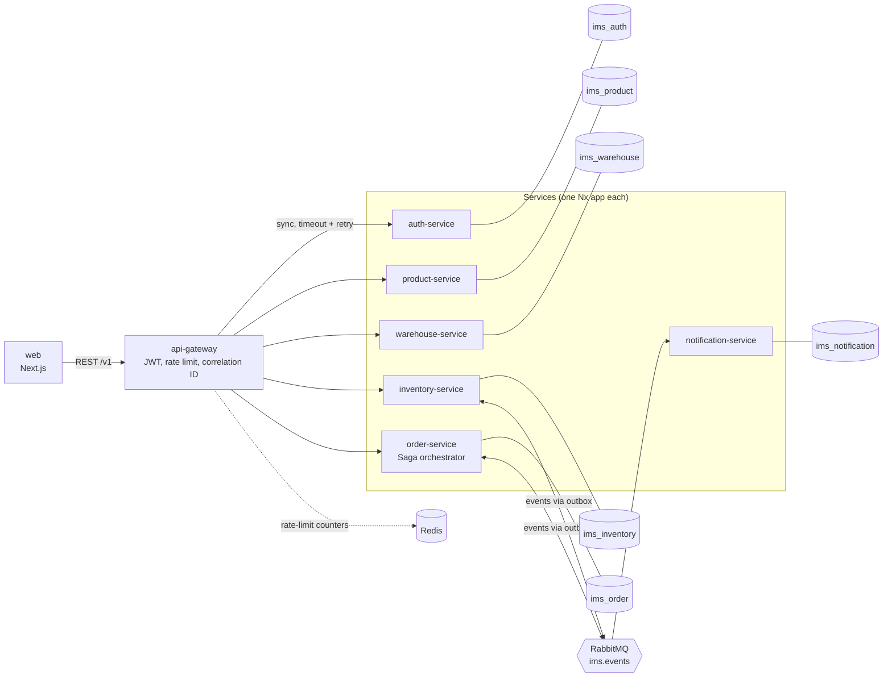
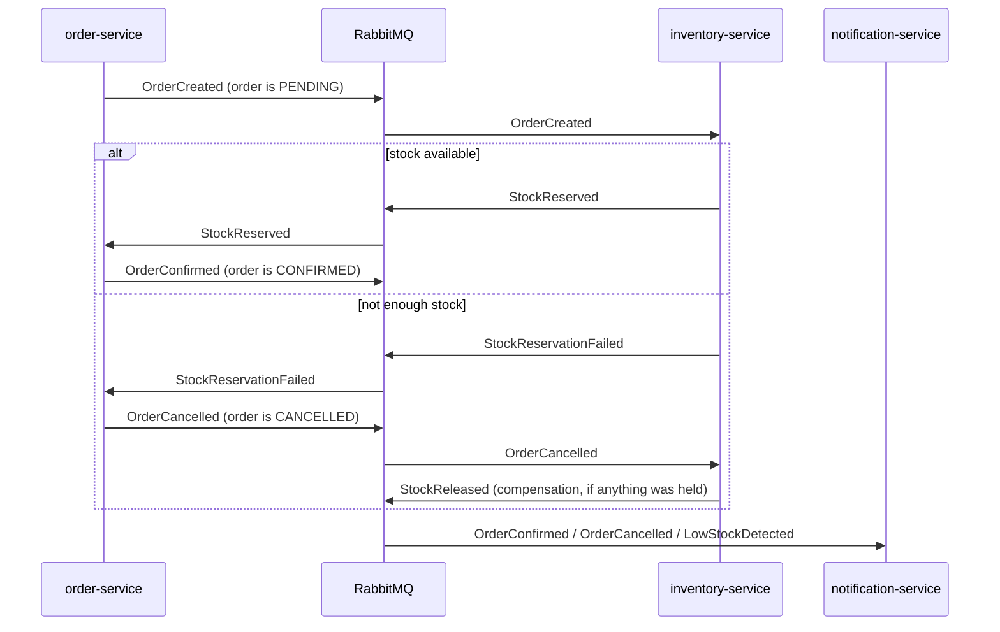

# Inventory Management System

An MVP of an enterprise-style inventory system, built as an Nx monorepo of
NestJS microservices with a Next.js frontend.

> **Build status:** Phase 4 of 7 is complete: login, the product catalogue,
> warehouses and stock (in, out, transfer, movement history) all work through
> the gateway. Orders, notifications and the frontend arrive in later phases;
> see [Roadmap](#roadmap).

## Architecture



**Order saga** (orchestrated by order-service, all steps asynchronous):



Key rules:

- The frontend talks **only** to `api-gateway`.
- Each service owns its **own database**; no service reads another's tables.
- Events are written to an **outbox table** in the same transaction as the
  state change, then relayed to RabbitMQ (no lost or phantom events).
- Consumers are **idempotent**: they record processed event IDs.
- Stock rows use **optimistic locking** so concurrent orders cannot oversell.

## Tech stack

| Area      | Choice                                                       |
| --------- | ------------------------------------------------------------ |
| Monorepo  | Nx 22, pnpm 9, TypeScript 5.9 (strict)                       |
| Backend   | NestJS 11, TypeORM 0.3 (migrations only), PostgreSQL 16      |
| Build     | Vite 7 with SWC (one Node bundle per service)                |
| Messaging | RabbitMQ 3.13 (Amazon MQ in production)                      |
| Cache     | Redis 7                                                      |
| Frontend  | Next.js App Router, Tailwind, shadcn/ui, TanStack Query, Zod |
| Quality   | ESLint 9, Prettier, Jest 30, Husky, lint-staged, Commitlint  |

## Repository layout

```
apps/
  api-gateway/            entry point: JWT check, rate limit, routing
  auth-service/           users, login, refresh, logout
  product-service/        categories, products (SKU, price, JSONB attributes)
  warehouse-service/      warehouses and their storage locations
  inventory-service/      stock levels, stock in/out/transfer, movement history
  ...                     remaining services and web arrive in later phases
libs/
  config/                 Zod env schemas + fail-fast validator
  common/                 guards, decorators, error filter, pagination, logger
  events/                 event names, payload contracts, envelope
  database/               TypeORM options factory, base entity, naming strategy,
                          Postgres error helpers, health check
docker/postgres/          init script: one database per service
docker-compose.yml        Postgres, Redis, RabbitMQ
tools/scaffold-app.sh     writes the Nx/Jest/Vite boilerplate for a new app
tools/vite/nest-app.ts    shared Vite + SWC config for every NestJS app
```

Shared libs contain **no business logic**. Dependencies are enforced by the
`@nx/enforce-module-boundaries` lint rule (see `eslint.config.mjs`):

```
apps      -> libs only (an app can never import another app)
config    -> (nothing)
events    -> (nothing)
common    -> config, events
database  -> config, common
```

## Getting started

Prerequisites: Node.js >= 22.12, pnpm 9 (`npm i -g pnpm@9`), Docker.

```bash
pnpm install        # install dependencies and git hooks
pnpm setup:env      # copy every .env.example to .env (skips existing files)
pnpm docker:up      # start Postgres, Redis, RabbitMQ and wait until healthy
pnpm dev            # start every service in watch mode
```

Then sign in through the gateway (seed users and their password are listed in
[apps/auth-service/README.md](apps/auth-service/README.md#seed-users)):

```bash
curl -s -X POST http://localhost:4000/v1/auth/login \
  -H 'content-type: application/json' \
  -d '{"email":"admin@ims.local","password":"<SEED_USER_PASSWORD>"}'
```

Services:

| App                                                   | Port | API docs                     | Health    |
| ----------------------------------------------------- | ---- | ---------------------------- | --------- |
| [api-gateway](apps/api-gateway/README.md)             | 4000 | <http://localhost:4000/docs> | `/health` |
| [auth-service](apps/auth-service/README.md)           | 4001 | <http://localhost:4001/docs> | `/health` |
| [product-service](apps/product-service/README.md)     | 4002 | <http://localhost:4002/docs> | `/health` |
| [warehouse-service](apps/warehouse-service/README.md) | 4003 | <http://localhost:4003/docs> | `/health` |
| [inventory-service](apps/inventory-service/README.md) | 4004 | <http://localhost:4004/docs> | `/health` |

Local infrastructure:

| Service     | Address                  | Credentials                  |
| ----------- | ------------------------ | ---------------------------- |
| PostgreSQL  | `localhost:5433`         | `ims` / `ims_local_password` |
| Redis       | `localhost:6379`         | none                         |
| RabbitMQ    | `localhost:5672`         | `ims` / `ims_local_password` |
| RabbitMQ UI | <http://localhost:15672> | same as above                |

Databases created on first start: `ims_auth`, `ims_product`, `ims_warehouse`,
`ims_inventory`, `ims_order`, `ims_notification`.

## Scripts

| Command             | What it does                                            |
| ------------------- | ------------------------------------------------------- |
| `pnpm dev`          | Run all apps in watch mode                              |
| `pnpm lint`         | ESLint for every project, including module boundaries   |
| `pnpm typecheck`    | `tsc --noEmit` for every project                        |
| `pnpm test`         | Unit tests for every project (no infrastructure needed) |
| `pnpm test:int`     | Integration tests (needs `pnpm docker:up`)              |
| `pnpm build`        | Build every app                                         |
| `pnpm verify`       | lint + typecheck + test + build                         |
| `pnpm format`       | Prettier write (`format:check` to verify only)          |
| `pnpm docker:up`    | Start local infrastructure                              |
| `pnpm docker:down`  | Stop it (data is kept)                                  |
| `pnpm docker:reset` | Stop it and delete all data volumes                     |

Run one project: `pnpm nx test common`. Run only what a change affects:
`pnpm nx affected -t lint typecheck test build`.

## Configuration

- All configuration comes from environment variables. Real `.env` files are
  git-ignored; only `.env.example` files are committed.
- The root `.env` holds shared infrastructure settings and is also read by
  Docker Compose. Each service adds its own (`PORT`, `DB_NAME`, ...) in
  `apps/<service>/.env`.
- Every service validates its environment against a Zod schema at boot
  (`libs/config`). An invalid or missing value stops the process immediately
  with a message listing every problem.

## Conventions

- **Commits** follow [Conventional Commits](https://www.conventionalcommits.org)
  (`feat(inventory): add stock transfer`), checked by Commitlint on `commit-msg`.
- **Pre-commit** runs ESLint and Prettier on staged files through lint-staged.
- **Errors** from every service share one JSON shape (`ErrorResponse` in
  `libs/common`): `statusCode`, `error` code, `message`, optional `details`,
  `correlationId`, `timestamp`, `path`.
- **Logs** are structured JSON (Pino). Every line carries the
  `x-correlation-id` of the request or event being handled.

## Decisions

Choices made where the brief was open, favouring the simpler option:

1. **Tool versions are pinned to releases that support Node 22.12**
   (Nx 22, TypeScript 5.9, ESLint 9, NestJS 11, TypeORM 0.3). The newest
   majors (Nx 24, ESLint 10, TypeORM 1.x) need Node >= 22.13, NestJS 12 is
   ESM-only, and TypeScript 7 is not yet supported by ts-jest or
   typescript-eslint. Upgrading is a follow-up, not an MVP concern.
2. **pnpm is installed with npm**, not Corepack, because the Corepack bundled
   with Node 22.12 fails signature verification for current pnpm releases.
3. **Single `package.json`** (Nx integrated style) instead of one per project:
   one version of every dependency, less boilerplate.
4. **Libs are not built separately.** Apps import them through TypeScript path
   aliases (`@ims/*`) and bundle them at build time. Libs still have their own
   `lint`, `typecheck` and `test` targets.
5. **Services are built with Vite, compiled by SWC.** Vite's default
   compiler (esbuild) cannot emit the decorator metadata NestJS dependency
   injection needs, so the SWC plugin does the TypeScript transform. The
   shared config is `tools/vite/nest-app.ts`. Two consequences: the build
   does not type-check (the `typecheck` target runs `tsc` for that), and an
   interface used as the type of a decorated parameter must be imported with
   `import type`. In development, `vite build --watch` rebuilds the bundle
   and `node --watch` restarts the service.
6. **One Postgres server locally, one database per service.** The isolation
   that matters (no shared schema, no cross-service queries) is kept, without
   running six containers. Production can use separate instances by changing
   `DB_HOST` per service.
7. **Role-to-permission mapping is static code** in `libs/common`, and the
   permissions are embedded in the access token. No permission tables or
   admin UI for the MVP.
8. **Docker Compose runs infrastructure only.** Services run on the host with
   `pnpm dev` for fast reloads; per-app Dockerfiles come in Phase 7.
9. **Synchronous calls use HTTP, not Nest TCP.** Every service needs an HTTP
   server anyway (Swagger, health checks), so the gateway forwards plain HTTP
   with a timeout and retries for idempotent requests. One protocol to debug,
   and services stay callable with curl.
10. **The gateway is a generic reverse proxy** driven by a routing table,
    rather than one hand-written controller per downstream endpoint. Request
    and response contracts are documented once, in each service's own Swagger.
11. **Every service verifies the JWT itself** instead of trusting identity
    headers set by the gateway. Verification is a local signature check, so
    it costs no network call, and a service is safe even if reached directly.
12. **Migrations run at service startup** (`DB_MIGRATIONS_RUN=true`) and are
    hand-written SQL. This keeps `pnpm dev` to one command. In production,
    set it to `false` and run migrations as a separate deploy step.
13. **Seed data is created at startup** when `SEED_DATA=true`, by an
    idempotent seeder inside each service, rather than by a separate script.
14. **Refresh tokens are JWTs with a server-side record** (hash only), which
    gives rotation, logout and reuse detection without a session store.
15. **Unit and integration tests are separate targets** (`test`, `test-int`),
    so unit tests never need Docker. CI runs both.
16. **Products and warehouses are archived, never deleted.** `DELETE` sets
    `isActive=false`. Stock and orders in other services refer to these IDs,
    and with a database per service there is no foreign key to protect those
    references. Categories and storage locations, which nothing outside
    their own service refers to, are deleted for real.
17. **Uniqueness is enforced by database constraints,** and the services
    translate the constraint violation into a `409` with a specific error
    code. There is no "check first, then insert", which would still lose a
    race between two concurrent requests.
18. **Product search uses `ILIKE`** on SKU and name, which is a sequential
    scan. That is fine at MVP size; a `pg_trgm` index is the next step if
    the catalogue grows. Attribute filtering does use an index (GIN).
19. **Seed rows have fixed IDs,** so the seed data of later services (stock
    levels, orders) can refer to the same products and warehouses without
    calling across services at startup.
20. **Stock is tracked per product per warehouse,** not per storage location.
    Locations are reference data for now; bin-level stock would add a
    dimension to every stock rule without changing the architecture.
21. **Stock changes use optimistic locking written out by hand**
    (`UPDATE ... WHERE id = ? AND version = ?`, retried up to 3 times) rather
    than TypeORM's `@VersionColumn`, so the mechanism is visible in one
    place. `CHECK` constraints in the database are the last line of defence
    against negative stock.
22. **inventory-service checks product and warehouse IDs only the first time**
    stock is recorded for a pair, with a synchronous call (timeout + retries)
    to the owning service. Later movements need no cross-service call, so
    day-to-day stock work keeps running if the catalogue is down.
23. **Stock responses carry IDs, not product or warehouse names.** Copying
    names into inventory-service would need events to keep them fresh; the
    frontend joins them from the catalogue instead.
24. **Low stock is a flag and a filter in this phase.** The moment an item
    crosses its threshold is detected and logged; the `LowStockDetected`
    event is published in Phase 5, together with the outbox.

## Roadmap

| Phase | Scope                                                           | Status  |
| ----- | --------------------------------------------------------------- | ------- |
| 1     | Workspace, tooling, shared libs, Docker Compose, root README    | Done    |
| 2     | auth-service + api-gateway, login working end to end            | Done    |
| 3     | product-service, warehouse-service                              | Done    |
| 4     | inventory-service: stock rules, movement history                | Done    |
| 5     | order-service (Saga, Outbox, idempotency), notification-service | Next    |
| 6     | Next.js frontend, all MVP screens                               | Pending |
| 7     | Tests, Swagger, Dockerfiles, GitHub Actions, final README       | Pending |
