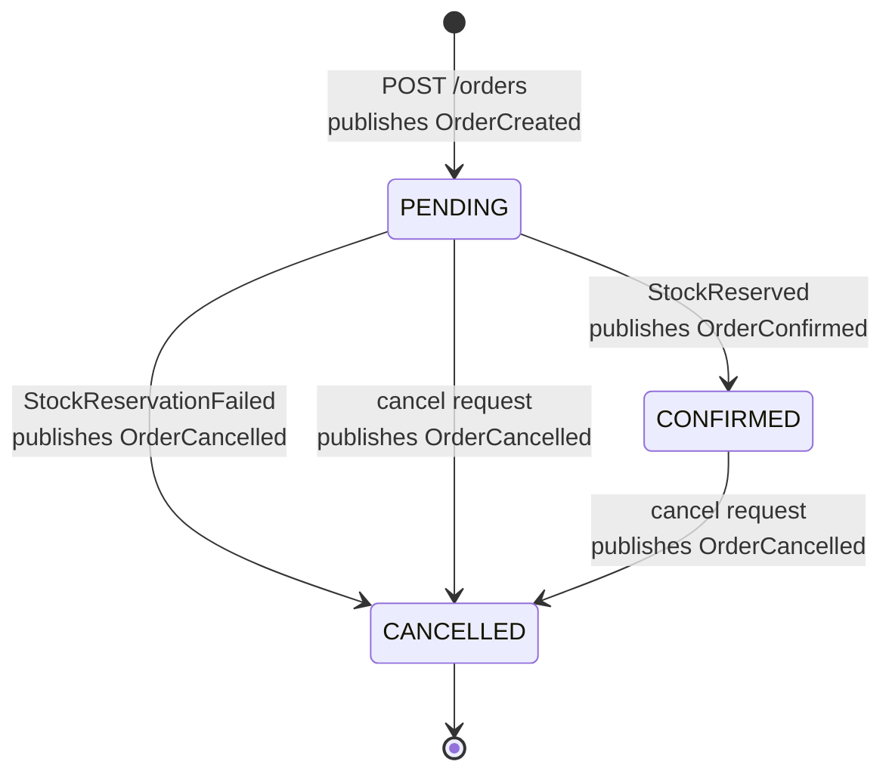

# order-service

Owns orders, and orchestrates the saga that reserves stock for them.

- **Port:** 4005 · **Database:** `ims_order` · **API docs:** <http://localhost:4005/docs>
- **Health:** `GET /health` (checks the database)

## API

Reached from the frontend through the gateway under `/v1`.

| Method | Path                 | Permission      | Description                                                                              |
| ------ | -------------------- | --------------- | ---------------------------------------------------------------------------------------- |
| GET    | `/orders`            | `orders:read`   | List, newest first; filter by `status`, `warehouseId`; `search` matches the order number |
| GET    | `/orders/:id`        | `orders:read`   | One order with its items                                                                 |
| POST   | `/orders`            | `orders:create` | Place an order; returns `PENDING`                                                        |
| POST   | `/orders/:id/cancel` | `orders:cancel` | Cancel a pending or confirmed order                                                      |

Staff can place and read orders; cancelling needs a manager or admin.

```json
POST /orders
{
  "warehouseId": "30000000-0000-4000-8000-000000000001",
  "items": [{ "productId": "20000000-0000-4000-8000-000000000004", "quantity": 3 }],
  "note": "Deliver before Friday"
}
```

The client sends product IDs and quantities only. SKU, name and price are
read from product-service and copied onto the order, so an order keeps
showing what was actually sold even if the catalogue changes later.

| Status | Code                                       | Meaning                                       |
| ------ | ------------------------------------------ | --------------------------------------------- |
| 400    | `PRODUCT_NOT_FOUND`, `WAREHOUSE_NOT_FOUND` | Unknown ID                                    |
| 400    | `PRODUCT_ARCHIVED`, `WAREHOUSE_ARCHIVED`   | Archived items cannot be ordered              |
| 409    | `ORDER_NOT_CANCELLABLE`                    | The order is already cancelled                |
| 503    | `CATALOG_UNAVAILABLE`                      | product- or warehouse-service was unreachable |

## The saga

An order needs two services to agree: order-service (the order) and
inventory-service (the stock). They have separate databases, so there is no
transaction that spans both. A saga replaces it with a sequence of local
transactions connected by events, plus a compensating action to undo a step.

order-service is the **orchestrator**: it starts the saga and decides what
each reply means.



`OrderCancelled` is what triggers the compensation: inventory-service
releases the reservation, if it made one.

Where the pieces are:

| File                                  | Role                                                       |
| ------------------------------------- | ---------------------------------------------------------- |
| `src/saga/order-state.ts`             | The state machine as pure data and functions (unit tested) |
| `src/orders/orders.service.ts`        | Request-driven steps: place, cancel                        |
| `src/saga/order-saga.service.ts`      | Event-driven steps: react to inventory-service's replies   |
| `src/saga/order-events.controller.ts` | RabbitMQ subscriptions (queue `ims.order.events`)          |

### Why it stays correct

- **Outbox.** A status change and the event announcing it are written in one
  transaction (`orders` + `outbox_events`). The relay publishes outbox rows
  afterwards and retries until RabbitMQ confirms. An order can never be
  saved without its event, or announced without being saved.
- **Idempotent consumers.** RabbitMQ delivers at least once. Each handler
  first inserts the event ID into `processed_events`, in the same
  transaction as its work; a duplicate finds the ID and is skipped.
- **Guarded transitions.** Every status change is
  `UPDATE orders SET status = ? WHERE id = ? AND status IN (...)`. If a user
  cancels at the same moment `StockReserved` arrives, exactly one of the two
  updates matches. A reply that arrives too late matches nothing and is
  ignored, while the `OrderCancelled` already published makes
  inventory-service release the stock.
- **Broker outage.** Orders are still accepted while RabbitMQ is down: they
  stay `PENDING` with their events waiting in the outbox, and complete when
  it returns.

## Configuration

See `.env.example`. Shared values come from the root `.env`.

| Variable                                       | Purpose                                        |
| ---------------------------------------------- | ---------------------------------------------- |
| `PORT`, `DB_NAME`                              | Service port and database                      |
| `JWT_ACCESS_SECRET`                            | Verifies access tokens issued by auth-service  |
| `RABBITMQ_URL`                                 | Broker for events                              |
| `OUTBOX_POLL_INTERVAL_MS`                      | How often the outbox relay runs (default 1000) |
| `PRODUCT_SERVICE_URL`, `WAREHOUSE_SERVICE_URL` | Where to look up products and warehouses       |
| `UPSTREAM_TIMEOUT_MS`, `UPSTREAM_RETRIES`      | Timeout and extra attempts for those lookups   |
| `DB_MIGRATIONS_RUN`                            | Apply pending migrations at startup            |

## Commands

```bash
pnpm nx serve order-service      # run in watch mode
pnpm nx test order-service       # unit tests (no infrastructure needed)
pnpm nx test-int order-service   # integration tests (needs pnpm docker:up)
pnpm nx build order-service      # production bundle in dist/apps/order-service
```

Integration tests use their own database, `ims_order_test`. They need no
RabbitMQ and no other service: catalogue lookups and the broker are replaced
by fakes, events are handed to the handlers directly, and the outbox relay is
run by hand.

## Try it

With everything running (`pnpm dev`), place an order as staff and watch it
move from `PENDING` to `CONFIRMED`:

```bash
TOKEN=$(curl -s -X POST http://localhost:4000/v1/auth/login \
  -H 'content-type: application/json' \
  -d '{"email":"staff@ims.local","password":"<SEED_USER_PASSWORD>"}' | jq -r .accessToken)

curl -s -X POST http://localhost:4000/v1/orders \
  -H "authorization: Bearer $TOKEN" -H 'content-type: application/json' \
  -d '{"warehouseId":"30000000-0000-4000-8000-000000000001","items":[{"productId":"20000000-0000-4000-8000-000000000004","quantity":3}]}'
```

The RabbitMQ management UI at <http://localhost:15672> shows the exchange,
queues and bindings.
